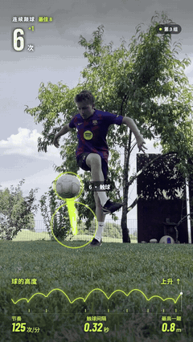
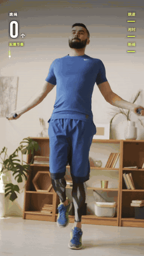
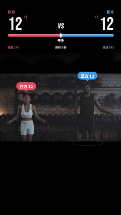
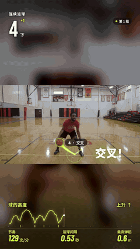

# ComboCam

[](https://github.com/cdt2019/combocam/actions/workflows/ci.yml)
[](LICENSE)

English | [中文](README.zh-CN.md)

Count **football juggling**, **jump rope** and **basketball dribbling** from a phone video, and render a vertical highlight video with effects.

<p align="center">
  
  
  
  
</p>

- **Juggling**: every touch, combos, and the height of each juggle. Ground bounces, catches, balancing the ball on the head and ground play do not count.
- **Jump rope**: every jump, rope breaks and pace. It detects slow-motion footage, double unders and "two hops per turn", picks the jumper when several people are in frame, and has a two-player battle mode.
- **Dribbling**: every bounce and each dribbling run. When the player faces the camera it also tells same-hand, crossover, between-the-legs and behind-the-back dribbles apart.
- **Effects video**:
  - glowing trails, impact bursts, counters and milestone banners;
  - a stats panel and an end card;
  - five color styles;
  - layouts that keep clear of short-video app overlays.

No training is involved:
- Detection uses COCO-pretrained YOLOX-s and pose uses RTMPose-m.
- Counting is hand-written rules on physical quantities: parabolic flight, gravity and the real size of the ball.

The renderer is Node + Skia. Every effect is a pure function of time, so frames render on many threads and the output is identical frame by frame on every run.

## Quick start

You need Python 3.10+, Node 18+ and FFmpeg. An NVIDIA GPU is strongly recommended: on CPU alone a 30-second clip takes over ten minutes.

```bash
pip install -r requirements.txt        # or requirements-gpu.txt with an NVIDIA GPU
python tools/fetch_assets.py           # download models and fonts
cd render && npm ci && cd ..

python -m combocam run juggling.mp4 -o out/        # juggling
python -m combocam jumprope jumprope.mp4 -o out/   # jump rope (--mode pk for a two-player battle)
python -m combocam dribble dribble.mp4 -o out/     # basketball dribbling
```

Each run writes three files: the effects video `out/<name>.<style>.mp4`, a track JSON and a report. For best results, shoot from a fixed phone with the whole body in frame and decent light.

## Accuracy

The test clips are Pexels stock videos, labeled frame by frame by hand. The table shows the **first run on each sport's latest test batch**. Those batches were labeled without looking at the algorithm's output, and no rule was tuned on them.

| | Test batch | Recall | Precision |
|---|---|---|---|
| Juggling | 18 clips, 60 touches (silhouettes, multi-shot edits) | 86.7% | 86.7% |
| Jump rope | 28 clips, 484 jumps | 99.6% | 98.4% |
| Dribbling | 7 clips, 47 bounces | 97.9% | 100% |

On the four earlier juggling batches (407 touches) the result is 96.3% recall and 96.6% precision, but the rules were tuned on those batches. All clips are stock footage; user-shot phone videos have not been evaluated systematically yet. How each number was reached, and the trade-offs along the way, are in the [development notes](docs/development.md).

## How it works

```
video ─ FFmpeg → 1080×1920 @ 30 fps ─┬─▶ analysis (Python) ───────────────────▶ track JSON ─┐
                                     │   YOLOX-s: people and ball                            │
                                     │   RTMPose-m: body keypoints                           │
                                     │   ball path → touches / bounces / jumps → counts      │
                                     └─▶ rendering (Node + Skia) ◀────────────────────────────┘
```

## Documentation

The detailed docs are written in Chinese:

| Doc | What it covers |
|---|---|
| [Install](docs/install.md) | dependencies, GPU setup, environment variables |
| [Usage](docs/usage.md) | commands and options, rejected videos, output files |
| [Architecture](docs/architecture.md) | pipeline, design choices, modules |
| [Track format](docs/track-format.md) | fields of the analysis JSON |
| [Juggling](docs/juggling.md) · [Jump rope](docs/jumprope.md) · [Dribbling](docs/dribble.md) | rules, accuracy and known limitations per sport |
| [Rendering](docs/rendering.md) | styles, layouts, safe areas, legibility, single-frame preview |
| [Performance](docs/performance.md) | timings and speed-ups |
| [Evaluation](docs/evaluation.md) | test videos, label format, evaluation and labeling tools |
| [Development notes](docs/development.md) | problems met, approaches tried, trade-offs, and how each step moved recall and precision |

## Status

This is a research prototype. The counting rules were checked clip by clip on a few hundred stock videos. They still make mistakes in new conditions such as low light, edited footage, crowds or unusual footwork; each sport's doc lists the known limitations.

Issues and labeled test videos are welcome; see [CONTRIBUTING.md](CONTRIBUTING.md).

## License

The code is released under the [MIT License](LICENSE).

Models, fonts and test videos are not included in this repository; their licenses are listed in [THIRD_PARTY_NOTICES.md](THIRD_PARTY_NOTICES.md). The source clips of the demo GIFs come from Pexels; see [docs/media/CREDITS.md](docs/media/CREDITS.md).
