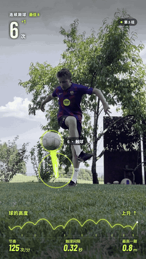
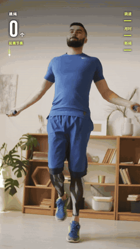
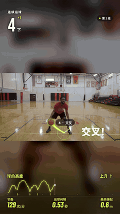

# ComboCam

[](https://github.com/cdt2019/combocam/actions/workflows/ci.yml)
[](LICENSE)

[English](README.md) | 中文

从一段手机视频里数**颠球**、**跳绳**、**篮球运球**，并生成带特效的竖版成片。

<p align="center">
  
  
  
  
</p>

- **颠球**：每一次触球、连击、每一颠的高度；落地、用手、头上平衡、在地上拨球都不算。
- **跳绳**：每一跳、断绳、跳速；能认出慢动作、双摇、"一圈跳两下"，多人入镜时挑出在跳的人，还有双人 PK。
- **篮球运球**：每一下触地、分组；面对镜头时判断单手、体前交叉、胯下、背后。
- **成片**：发光拖尾、触球冲击波、计数、里程碑横幅、数据面板、片尾成绩卡；5 种风格，可以避开短视频 App 的界面遮挡。

不需要训练：检测用 COCO 预训练的 YOLOX-s，关键点用 RTMPose-m，计数全靠规则和物理量（抛物线、重力、球的真实大小）。
渲染用 Node + Skia，特效是时间的纯函数，多线程渲染，每次结果逐帧相同。

## 快速开始

需要 Python 3.10+、Node 18+、FFmpeg；有 NVIDIA 显卡会快很多（只用 CPU 时 30 秒视频要十几分钟）。

```bash
pip install -r requirements.txt        # 有 NVIDIA 显卡用 requirements-gpu.txt
python tools/fetch_assets.py           # 下载模型和字体
cd render && npm ci && cd ..

python -m combocam run juggling.mp4 -o out/        # 颠球
python -m combocam jumprope jumprope.mp4 -o out/   # 跳绳（--mode pk 双人 PK）
python -m combocam dribble dribble.mp4 -o out/     # 篮球运球
```

输出：`out/<名>.<风格>.mp4` 成片、轨迹 JSON、报告。手机固定、全身入镜、光线正常的视频效果最好。
详见 [安装](docs/install.md) 和 [命令行用法](docs/usage.md)。

## 准确率

在 Pexels 图库视频上人工逐帧标注，下表是各项目**最后一批测试集第一次跑**的结果（标注时不看算法结果，规则也没按它调过）：

| | 测试集 | 召回 | 精确率 |
|---|---|---|---|
| 颠球 | 18 段、60 次触球（剪影、多镜头剪辑等难素材） | 86.7% | 86.7% |
| 跳绳 | 28 段、484 跳 | 99.6% | 98.4% |
| 运球 | 7 段、47 下 | 97.9% | 100% |

颠球在前四批 407 次触球上是 96.3% / 96.6%（按它们调过规则）。所有素材都来自图库，用户实拍的视频还没有系统测过。
详见 [数据集和评估](docs/evaluation.md)；每一步是怎么提上来的、为什么这样取舍，见 [开发记录](docs/development.md)。

## 怎么做的

```
视频 ─ FFmpeg 统一成 1080×1920@30 ─┬─▶ 分析（Python）─────────────▶ 轨迹 JSON ─┐
                                  │   YOLOX-s 检测人和球                        │
                                  │   RTMPose-m 人体关键点                      │
                                  │   选球的轨迹 → 触球 / 触地 / 每一跳 → 计数   │
                                  └─▶ 渲染（Node + Skia）◀─────────────────────┘
```

## 文档

| | |
|---|---|
| [安装](docs/install.md) | 依赖、GPU、环境变量 |
| [命令行用法](docs/usage.md) | 所有命令和参数、不出片的情况、输出文件 |
| [整体结构](docs/architecture.md) | 流水线、设计取舍、各模块 |
| [轨迹 JSON 格式](docs/track-format.md) | 分析结果的字段 |
| [颠球](docs/juggling.md) · [跳绳](docs/jumprope.md) · [运球](docs/dribble.md) | 各项目的规则、准确率、已知局限 |
| [成片特效](docs/rendering.md) | 风格、布局、安全区、可读性、单帧预览 |
| [速度](docs/performance.md) | 实测用时和提速 |
| [数据集和评估](docs/evaluation.md) | 测试视频、标注格式、评估和标注工具 |
| [开发记录：问题、方案和取舍](docs/development.md) | 遇到的问题、试过的方案、怎么选的，每一步对召回率、精确率的影响 |

## 现状

这是一个研究原型。计数规则是在几百段图库视频上逐段核对出来的，在新的场景里（暗光、剪辑、多人、特殊步法）还会错，
各项目文档的"已知局限"里列了已知的问题。欢迎提交 issue 和带标注的测试视频，见 [CONTRIBUTING.md](CONTRIBUTING.md)。

## 许可

代码以 [MIT](LICENSE) 许可发布。模型、字体、测试视频不随仓库分发，各自的许可见 [THIRD_PARTY_NOTICES.md](THIRD_PARTY_NOTICES.md)。
演示动图里的原视频来自 Pexels，见 [docs/media/CREDITS.md](docs/media/CREDITS.md)。
